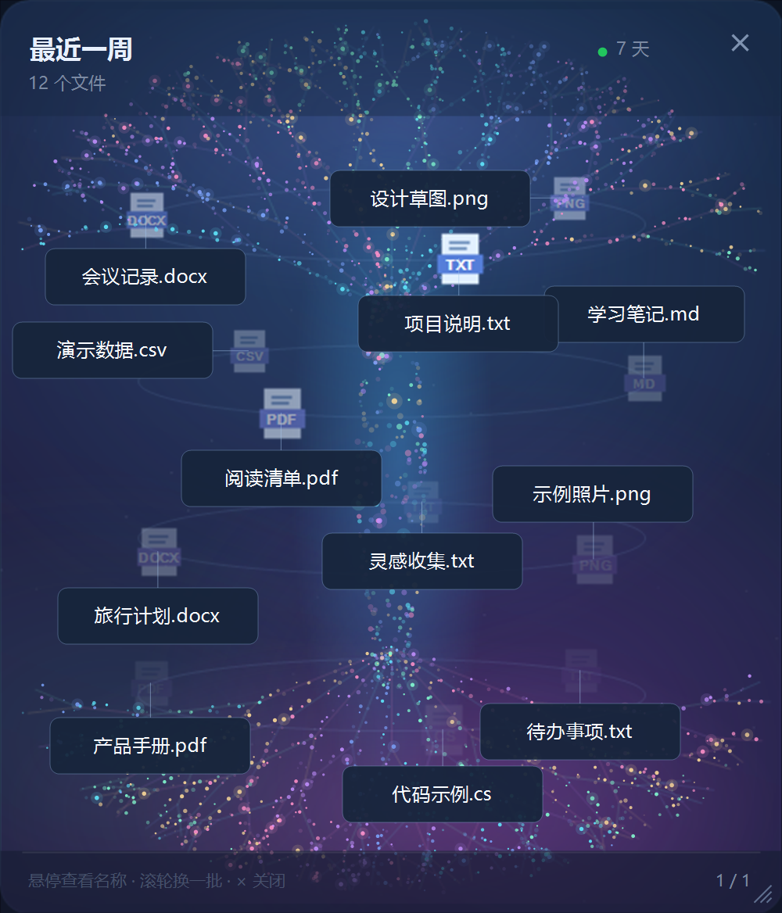

# 最近一周 · 粒子光柱桌面文件卡片

Windows 桌面小工具，以多色粒子光柱展示最近 7 天使用过的文件。顶部树冠和底部树根随卡片宽度展开，文件图标分层环绕光柱旋转。



## 功能

- 最近文件列表、按时间淡出、分页、单击打开文件及右键操作。
- 多色粒子光柱、树冠和树根、前后景图标旋转。
- 独立绘制的清晰文件名，可点击标签打开文件。
- 拖动卡片边缘调整大小，或右键“设置宽高”输入像素值。
- 刷新间隔：30 秒、1 分钟、3 分钟、5 分钟及自定义 1–86400 秒。
- 桌面层显示、可选置顶、可选开机启动、托盘操作。

## 环境与构建

Windows 桌面环境；需要 .NET Framework 4.x、Windows Forms 和系统 C# 编译器。现代 Windows 通常已安装 .NET Framework 4.x。项目不使用 NuGet 包，不附带 Microsoft 的运行库、字体或关联应用图标。

在项目目录的 PowerShell 中执行：

```powershell
.\build.ps1
.\build.ps1 -RunTests
```

构建产物是 `build\RecentWidget.exe`。在资源管理器中正常双击启动。日常使用不要求管理员权限。关闭按钮、Esc 或托盘菜单均可退出。

## 操作

- 拖动标题或空白区域移动卡片；拖动四边或四角调整宽高。
- 右键卡片、文件或托盘，选择“设置宽高”或“刷新间隔”。
- 选择间隔后从当前时刻重新计时，设置会在下次启动恢复。
- 图标或名称标签可打开对应文件；滚轮切换批次。
- 通过托盘切换网格模式、桌面模式、置顶或开机启动。

尺寸范围为 420×380 至 4000×4000 像素。每页最多 12 个文件；较矮的卡片会减少每页数量。

## 数据与隐私

程序在正常模式中读取当前用户 Windows Recent 文件夹的快捷方式，并解析其目标路径。只读最近使用记录，不修改文档。并非所有应用都会写入 Recent 记录，因此本工具不是完整的文件访问监控器。

程序没有内置网络上传、账号登录、统计分析或遥测。打开文件会调用系统及关联应用，关联应用自身可能使用网络，具体行为取决于该应用。

公开预览和自动测试使用虚构文件，不读取实际的最近文件列表或已保存的个人窗口设置。详细日志默认关闭；只有手动添加 `--diagnostics` 才启用。日志、正常模式截图或公开 Issue 仍可能暴露文件名和路径，分享前请脱敏。详见 [PRIVACY.md](PRIVACY.md)。


## 安全生成演示图

```powershell
.\build\RecentWidget.exe --shot docs\preview.png --demo --no-hover
```

## 完整性标签排障

如果程序提示正在 Low 完整性下运行，可能是所在目录或 exe 被加上了 Low 标签。低完整性会影响桌面 COM 调用以及关联应用的临时文件写入。

可先在正常用户目录重新构建并从资源管理器启动。若仍有 Low 标签，可由文件所有者或管理员在终端中仅修复这个可执行文件：

```powershell
icacls .\build\RecentWidget.exe /setintegritylevel M
```

权限不足时需要以管理员身份执行该修复命令。修复后关闭管理员终端，再从资源管理器正常启动。不要降低 Office、用户文档或系统目录的安全权限。背景资料：[Microsoft Mandatory Integrity Control](https://learn.microsoft.com/en-us/windows/win32/secauthz/mandatory-integrity-control)。

## 测试

`tools/Test.ps1` 编译并运行图像运动连续性、文件打开目标、名称布局、刷新定时器和调整尺寸测试。测试数据为合成数据，不实际打开用户文档。真实桌面 Shell 与关联应用的端到端打开行为仍需在普通桌面会话下手动验证。

## 许可

Copyright (c) 2026 Hemingchu。采用 [MIT License](LICENSE)，允许商业使用、修改及闭源分发；分发软件或其重要部分时必须保留版权声明和许可声明。软件按许可证原文所述按现状提供，不作担保。

[中文说明](docs/LICENSE-NOTES.zh-CN.md)仅用于理解；正式授权以 LICENSE 中的完整英文文本为准。第三方平台组件不因本项目采用 MIT 而重新获得授权，详见 [THIRD_PARTY.md](THIRD_PARTY.md)。
